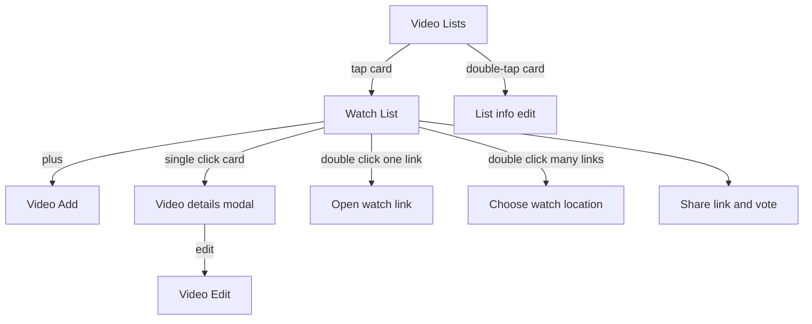

# Video watchlist MVP

Mobile-first HTML5 web app. A phone is the primary layout; the Watch List grid adds columns when the screen is wider. Stack stays vanilla HTML, CSS, and JavaScript in the browser, plus a small Node server and SQLite. Sharing stays a private link with no accounts. Each phone keeps a random device id, and an optional display name, so votes can be counted per person.

Two behaviors in the one-sentence description need data the screen list does not name. They are included so those sentences can actually work:

- Each video stores one or more watch links (location label plus URL). The Add/Edit form gains a Watch links section for them.
- Mark viewed is a control on the video details modal, because the Watch List filter and “reset all watched flags” need a per-video viewed flag.

## 1. One-sentence description

This application lets a user create a video watchlist, mark a video as viewed after they watch it, share that watchlist with other users, and vote on which video to watch next.

## 2. Target user

People who like to watch movies, TV shows, and YouTube videos, and who want those titles in lists they can share.

## 3. Core use case

Create a video watchlist, add videos to it, and watch the videos on that list. After watching, mark the video viewed. Share the list so other people can open it and vote on what to watch next.

## 4. MVP feature list

- Create more than one video list, each with a name and cover art the user selects or uploads.
- Open a list and see its videos as poster cards.
- Add a video from TMDB, which fills title, description, parental guidance rating, genre, and poster URL.
- Enter a video by hand when search has no match, including a poster upload. This is the path for YouTube and anything else outside TMDB.
- Edit or delete a video that is already on a list.
- Store one or more watch links per video (a location name and a URL).
- Mark a video viewed, filter the list by watched or unwatched, and reset every watched flag on that list back to unwatched.
- Sort by video name by default, and also sort by watch location.
- Double-click a card to open the only watch link, or to list the locations when there are several.
- Share a list with a private link so other people can open and update it.
- Vote on which not-yet-viewed video to watch next. One current vote per device per list. The list shows the leading pick.

## 5. Screens

### Video Lists Screen

Purpose: present the video lists and let the user select one.

Design: each list is a horizontal card. The left section is cover art the user selected or uploaded. The rest of the card shows the list name.

Actions:

- Tap the card: open that Watch List Screen.
- Double-tap the card: open the list info screen in edit mode.

The list info screen (opened by double-tap, and by a create action on this screen) edits the list name and cover art, then saves.

### Watch List Screen

Purpose: display every video in the selected watchlist.

Design and elements:

- A toggle to filter videos by watched or unwatched.
- Default sort by video name, plus a sort by watch location. Watch location uses the first watch link’s location label.
- A button with a plus icon that opens Video Add/Edit in Add mode.
- A control to reset all watched flags on this list to unwatched.
- Share and vote live on this screen: copy the private link, and vote among unwatched videos. The current leading vote is visible on the list.
- Videos are cards in a responsive grid: one column on a phone, more columns as the screen gets wider.
- Each video card is mostly the poster. The title sits underneath the poster.

Actions:

- Single click a card: open the video details modal.
- Double click a card: if the video has one watch link, open that link. If it has more than one, show the links and locations so the user can choose how to watch.

On a touch phone, click and double-click are tap and double-tap. The first tap waits briefly so a double-tap can still open the watch link.

Video details modal:

- Name, plot description, and parental guidance rating.
- A button that opens Video Add/Edit in Edit mode.
- A control to mark the video viewed or not viewed.
- A control to vote for this video as what to watch next.

### Video Add/Edit Screen

Purpose: add a video to the watchlist, or edit an existing video.

Design and elements:

- Search TMDB button. Opens a search window. Choosing a result copies title, description, parental guidance rating, genre, and poster URL into the app database and into the form fields.
- Enter In Video button. Used when the video cannot be found. The user enters title, description, parental guidance rating, and genre, and uploads a poster image.
- Watch links. One or more rows of location label plus URL, so double-click and sort-by-location have data to use. A YouTube video is a manual entry whose link is the YouTube URL.
- Save button. Saves to the database and associates the video with the current watchlist.
- Delete button. Removes the video from the system and from the watchlist.

Actions:

- Edit mode shows the fields immediately so the user can update and save.
- Add mode shows the fields only after the user clicks Enter In Video, or after they select a TMDB result.

## 6. Analytics events

First-party events only. Each event stores the device id, list id when there is one, and a timestamp. Search text, titles, and URLs are not stored.

Activation: a list is created, a video is added, a watch link is opened, and a second device opens the share link.

- `app_opened`
- `list_created`
- `list_opened`
- `list_edited`
- `share_link_copied`
- `list_joined` — this device opened a share link for the first time
- `tmdb_search` — property `result_count`
- `video_added` — property `source` (`tmdb` or `manual`)
- `video_edited`
- `video_deleted`
- `details_opened`
- `video_marked_watched`
- `video_marked_unwatched`
- `watched_filter_changed` — property `filter` (`watched` or `unwatched`)
- `sort_changed` — property `sort` (`name` or `watch_location`)
- `watched_flags_reset`
- `watch_link_opened` — property `link_count` (`one` or `many`)
- `vote_cast`

## 7. Simple build plan

Files to add:

- [index.html](index.html) — Video Lists, Watch List, list info, details modal, Add/Edit, TMDB search
- [css/app.css](css/app.css) — mobile-first layout, horizontal list cards, responsive video-card grid, 44px targets
- [js/app.js](js/app.js) — screens, tap versus double-tap, device id, API calls, analytics
- [server/index.js](server/index.js) — lists, videos, watch links, votes, share, TMDB proxy, poster upload, events
- [server/db.js](server/db.js) — SQLite tables
- [.env.example](.env.example) — `TMDB_API_KEY` and port

Data:

- List: id, share token, name, cover image path, created time
- Video: id, list id, title, plot, parental rating, genre, poster path or URL, watched flag, TMDB id when present, source (`tmdb` or `manual`)
- Watch link: id, video id, location label, URL, sort order
- Vote: list id, video id, device id, display name, updated time. One row per device per list.
- Event: name, device id, list id, properties, timestamp

Build order:

1. Mobile screens with sample lists and videos, including tap, double-tap, the details modal, and the responsive card grid.
2. List create/edit with name and cover image.
3. Shared API and share link so a second browser session sees the same list, videos, and votes.
4. TMDB search that fills the form, then manual entry and poster upload.
5. Watch links, watched filter, reset, and both sorts.
6. Vote for what to watch next, one vote per device.
7. Analytics events.
8. Browser check on a phone-width viewport and a wider viewport: create a list, add from search and by hand, save a watch link, mark viewed, filter and sort, share, join from a second session, and vote.

A free [TMDB](https://www.themoviedb.org/) key is required before search works. TMDB attribution stays in the UI. Poster uploads and list cover art are stored by the server. The share link is the access control, so it stays private to the people who should see that list.
